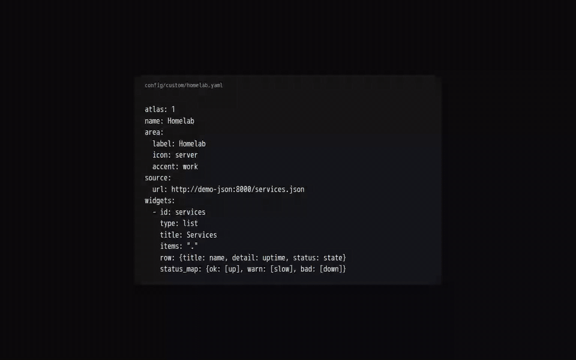

# Atlas

A self-hosted personal dashboard you open every day. Atlas pulls the things you
would otherwise check in six apps (weather, money, school, sleep, habits,
listening, work shifts) into one page of widgets you arrange yourself, and keeps
its own archive of whatever it can.

**[Read the Atlas Manual →](https://fazorath.github.io/atlas-dashboard/)**



Each subject is a **module**. The first time you open Atlas, **Setup** walks
you through it in the browser: claim the install, say who it's for and where
you are, then switch on modules and connect each one, with a **Test** button
that tells you whether it works before you save. Weather and Habits need no
account and start on.

| Module | Area | Needs | On by default | Manual |
|---|---|---|---|---|
| `open_meteo` | Weather | nothing: your coordinates | on | [Weather](https://fazorath.github.io/atlas-dashboard/modules/weather/) |
| `habits` | Habits | nothing | on | [Habits](https://fazorath.github.io/atlas-dashboard/modules/habits/) |
| `work` | Work | nothing: you enter your weekly shifts | off | [Work](https://fazorath.github.io/atlas-dashboard/modules/work/) |
| `securo` | Money | a self-hosted Securo | off | [Money](https://fazorath.github.io/atlas-dashboard/modules/money/) |
| `audiobookshelf` | Listening | a self-hosted Audiobookshelf + API key | off | [Listening](https://fazorath.github.io/atlas-dashboard/modules/listening/) |
| `canvas` | School | a Canvas calendar-feed URL | off | [School](https://fazorath.github.io/atlas-dashboard/modules/school/) |
| `google_health` | Health | a Google Cloud OAuth client (Fitbit / Pixel Watch) | off | [Health](https://fazorath.github.io/atlas-dashboard/modules/health/) |

## Quick start

```bash
git clone https://github.com/Fazorath/atlas-dashboard.git atlas && cd atlas
cp .env.example .env && chmod 600 .env
$EDITOR .env      # POSTGRES_PASSWORD, and ATLAS_SECRET_KEY from `openssl rand -base64 32`
docker compose up -d --build
docker compose logs atlas-api | grep 'setup code'
```

Then open <http://127.0.0.1:8188> and follow Setup. The setup code from the
log proves you run the machine; you then pick the **Owner passphrase**, which
is what lets you change settings later, from the Status screen.

Setup writes `config/` for you, as plain YAML you can still edit by hand
(changes apply within seconds, no restart). Passwords and tokens you enter go
to an encrypted store in the database, sealed with `ATLAS_SECRET_KEY` — back
that key up with `.env`.

**Only settings are protected.** Anyone who can open Atlas can read it and
tick your habits. Its ports bind to `127.0.0.1`; put a reverse proxy with auth,
or a private network such as Tailscale, in front of it rather than publishing
it to the open internet.

Want to look around first? [Fill it with demo data](https://fazorath.github.io/atlas-dashboard/start/demo-data/).

## The manual

- [Install](https://fazorath.github.io/atlas-dashboard/start/install/) and [Configuration](https://fazorath.github.io/atlas-dashboard/start/configuration/)
- [Today](https://fazorath.github.io/atlas-dashboard/using/today/), [Boards & Widgets](https://fazorath.github.io/atlas-dashboard/using/boards-and-widgets/), [Sync & freshness](https://fazorath.github.io/atlas-dashboard/using/sync-and-freshness/)
- [Custom modules](https://fazorath.github.io/atlas-dashboard/next/custom-modules/): add your own widgets with one YAML file, from static links to numbers pulled from any JSON API, with a Home Assistant example
- A page per module: what it shows, what you need, setup, config keys, what it stores, and its gotchas
- [Updating](https://fazorath.github.io/atlas-dashboard/operate/updating/), [Backups](https://fazorath.github.io/atlas-dashboard/operate/backups/), [Troubleshooting](https://fazorath.github.io/atlas-dashboard/operate/troubleshooting/)

Its source is in [`docs/manual/`](docs/manual/); design decisions are in
[`docs/adr/`](docs/adr/) and the vocabulary in [`CONTEXT.md`](CONTEXT.md).

## Early testers

Atlas is being worked on in the open over the next few weeks, and early testers
are welcome. Install it, try it with demo data or your own, and open an issue
for anything that breaks or anything you wish it did.

Want to try it early? [Open an issue](https://github.com/Fazorath/atlas-dashboard/issues/new/choose)
for a bug or an idea; that's the whole process, and nothing personal is collected.

## What's next

- A catalog of community modules to browse and install.
