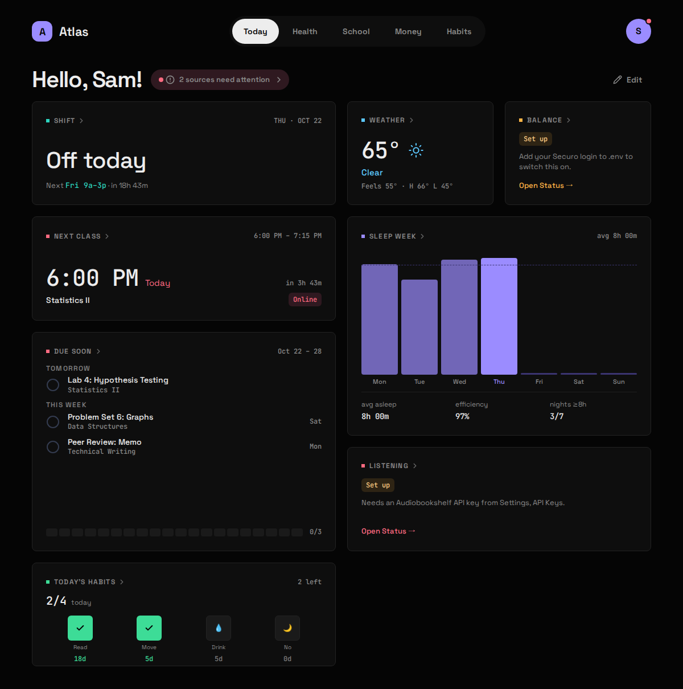

# Atlas

A self-hosted personal dashboard you open every day. Atlas pulls the things you
would otherwise check in six apps (weather, money, school, sleep, habits,
listening, work shifts) into one page of widgets you arrange yourself, and keeps
its own archive of whatever it can.

**[Read the Atlas Manual →](https://fazorath.github.io/atlas-dashboard/)**



Each subject is a **module** you switch on in one YAML file. A fresh install
starts with just Weather and Habits, which need no account; switch on the rest
as you connect the apps you already run or use.

| Module | Area | Needs | Example config | Manual |
|---|---|---|---|---|
| `open_meteo` | Weather | nothing: your coordinates | on | [Weather](https://fazorath.github.io/atlas-dashboard/modules/weather/) |
| `habits` | Habits | nothing | on | [Habits](https://fazorath.github.io/atlas-dashboard/modules/habits/) |
| `work` | Work | nothing: you enter your weekly shifts | off | [Work](https://fazorath.github.io/atlas-dashboard/modules/work/) |
| `securo` | Money | a self-hosted Securo | off | [Money](https://fazorath.github.io/atlas-dashboard/modules/money/) |
| `audiobookshelf` | Listening | a self-hosted Audiobookshelf + API key | off | [Listening](https://fazorath.github.io/atlas-dashboard/modules/listening/) |
| `canvas` | School | a Canvas calendar-feed URL | off | [School](https://fazorath.github.io/atlas-dashboard/modules/school/) |
| `google_health` | Health | a Google Cloud OAuth client (Fitbit / Pixel Watch) | off | [Health](https://fazorath.github.io/atlas-dashboard/modules/health/) |

## Quick start

```bash
git clone https://github.com/Fazorath/atlas-dashboard.git atlas && cd atlas
cp .env.example .env && chmod 600 .env     # secrets: DB password, tokens
$EDITOR .env                               # set POSTGRES_PASSWORD (not change-me)
cp -r config.example config                # everything else
$EDITOR config/atlas.yaml                  # your name, timezone, modules to add
$EDITOR config/modules/open_meteo.yaml     # your coordinates
docker compose up -d --build
```

Then open <http://127.0.0.1:8188>. Weather fills in at the next :07, or now with
`curl -X POST 127.0.0.1:8187/api/sync/weather`.

**Atlas has no login yet.** Its ports bind to `127.0.0.1`; put a reverse proxy
with auth, or a private network such as Tailscale, in front of it rather than
publishing it to the open internet.

Want to look around first? [Fill it with demo data](https://fazorath.github.io/atlas-dashboard/start/demo-data/).

## The manual

- [Install](https://fazorath.github.io/atlas-dashboard/start/install/) and [Configuration](https://fazorath.github.io/atlas-dashboard/start/configuration/)
- [Today](https://fazorath.github.io/atlas-dashboard/using/today/), [Boards & Widgets](https://fazorath.github.io/atlas-dashboard/using/boards-and-widgets/), [Sync & freshness](https://fazorath.github.io/atlas-dashboard/using/sync-and-freshness/)
- A page per module: what it shows, what you need, setup, config keys, what it stores, and its gotchas
- [Updating](https://fazorath.github.io/atlas-dashboard/operate/updating/), [Backups](https://fazorath.github.io/atlas-dashboard/operate/backups/), [Troubleshooting](https://fazorath.github.io/atlas-dashboard/operate/troubleshooting/)

Its source is in [`docs/manual/`](docs/manual/); design decisions are in
[`docs/adr/`](docs/adr/) and the vocabulary in [`CONTEXT.md`](CONTEXT.md).

## Early testers

Atlas is being worked on in the open over the next few weeks, and early testers
are welcome. Install it, try it with demo data or your own, and open an issue
for anything that breaks or anything you wish it did.

Want to try it early? [Sign up as a tester](https://docs.google.com/forms/d/e/1FAIpQLSdxZBcTgOdY8poCUWc8kH8xmdDmS68RYQbLGJXGSs1on70KTw/viewform)
and I'll email you when new releases land.

## What's next

- **[Custom modules](https://fazorath.github.io/atlas-dashboard/next/custom-modules/)**:
  add your own widgets from inside the app with a short YAML file, from static
  links and notes to numbers pulled from any JSON API you run.
- A catalog of community modules to browse and install.
