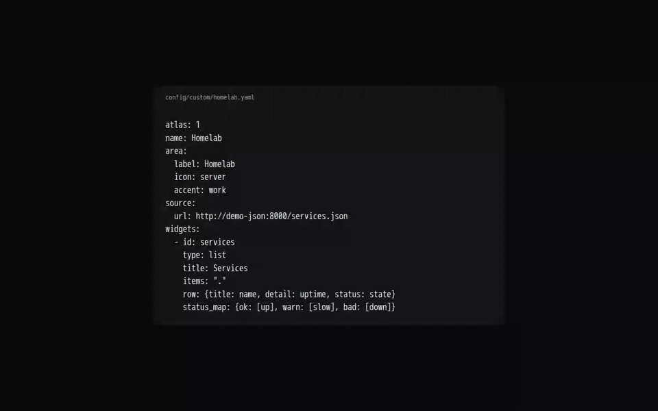
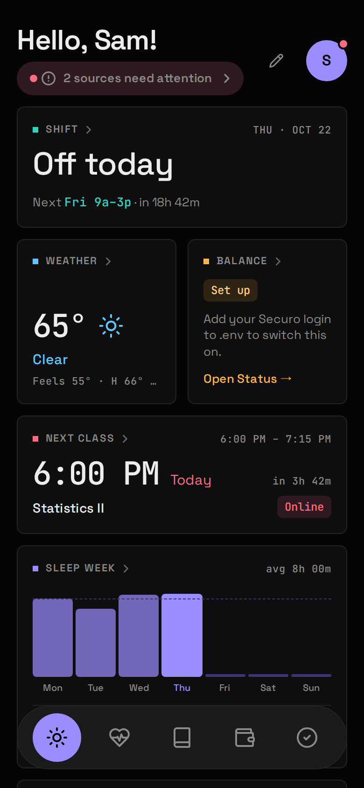

# Atlas

A self-hosted personal dashboard you open every day. Atlas pulls the things you
would otherwise check in six apps (weather, money, school, sleep, habits,
listening, work shifts) into one page of widgets you arrange yourself, and keeps
its own archive of whatever it can.

**[Read the Atlas Manual →](https://fazorath.github.io/atlas-dashboard/)**



Each subject is a **module**. The first time you open Atlas, **Setup** walks
you through it in the browser: claim the install, say who it's for and where
you are, then switch on modules and connect each one, with a **Test** button
that tells you whether it works before you save. Weather and Habits need no
account and start on.

| Module | Area | Needs | On by default | Manual |
|---|---|---|---|---|
| `open_meteo` | Weather | nothing: your coordinates | on | [Weather](https://fazorath.github.io/atlas-dashboard/modules/weather/) |
| `habits` | Habits | nothing | on | [Habits](https://fazorath.github.io/atlas-dashboard/modules/habits/) |
| `work` | Work | nothing: you enter your weekly shifts | off | [Work](https://fazorath.github.io/atlas-dashboard/modules/work/) |
| `securo` | Money | a self-hosted Securo | off | [Money](https://fazorath.github.io/atlas-dashboard/modules/money/) |
| `audiobookshelf` | Listening | a self-hosted Audiobookshelf + API key | off | [Listening](https://fazorath.github.io/atlas-dashboard/modules/listening/) |
| `canvas` | School | a Canvas calendar-feed URL | off | [School](https://fazorath.github.io/atlas-dashboard/modules/school/) |
| `google_health` | Health | a Google Cloud OAuth client (Fitbit / Pixel Watch) | off | [Health](https://fazorath.github.io/atlas-dashboard/modules/health/) |

## What you need

An always-on machine with Docker and the Compose plugin: a NAS, a Raspberry Pi 4 or 5,
an old laptop or mini PC, or a VPS (about $5 a month is plenty). A laptop works, but
Atlas only syncs while it is on. A hosted Atlas run for you is out of scope: it is your
install, on your machine.

## Quick start

```bash
curl -fsSL https://github.com/Fazorath/atlas-dashboard/releases/latest/download/install.sh | sh
```

That makes an `atlas` folder with the release `docker-compose.yml`, a `.env` with two
generated secrets and `config/`, starts Atlas from the published images, and prints the
address and the one-time setup code. Open <http://127.0.0.1:8188>, enter the code, pick
the **Owner passphrase**, and follow Setup. **Back up `atlas/.env`** now: it holds the key
that seals the passwords you enter in Setup. Versions and what changed are on the
[Releases](https://github.com/Fazorath/atlas-dashboard/releases/latest) page.

On a remote machine, reach it through an SSH tunnel
(`ssh -L 8188:127.0.0.1:8188 <user>@<host>`) or Tailscale. Setup writes `config/` for
you, as plain YAML you can still edit by hand (changes apply within seconds, no
restart).

**Only settings are protected.** Anyone who can open Atlas can read it and tick your
habits. Its ports bind to `127.0.0.1`; put a reverse proxy with auth, or a private
network such as Tailscale, in front of it rather than publishing it to the open
internet. To build from source instead, see
[Install](https://fazorath.github.io/atlas-dashboard/start/install/#build-from-source).

## Try it with demo data in 60 seconds

Finish Setup first (its Place step gives the weather its coordinates). Then, in
`atlas/config/atlas.yaml`, add `demo: true` and make sure `modules:` lists the ones the demo fills (keep the other keys Setup wrote):

```yaml
modules:
  - open_meteo
  - habits
  - work
  - canvas
  - google_health
demo: true
```

```bash
cd atlas
docker compose restart atlas-api
docker compose exec atlas-api python -m app.demo
curl -X POST 127.0.0.1:8187/api/sync/weather
```

Reload the page: a made-up student's week fills Today. Details, and how to leave demo
mode, are on the [demo data page](https://fazorath.github.io/atlas-dashboard/start/demo-data/).



## The manual

- [Install](https://fazorath.github.io/atlas-dashboard/start/install/) and [Configuration](https://fazorath.github.io/atlas-dashboard/start/configuration/)
- [Today](https://fazorath.github.io/atlas-dashboard/using/today/), [Boards & Widgets](https://fazorath.github.io/atlas-dashboard/using/boards-and-widgets/), [Sync & freshness](https://fazorath.github.io/atlas-dashboard/using/sync-and-freshness/)
- A page per module: what it shows, what you need, setup, config keys, what it stores, and its gotchas
- [Updating](https://fazorath.github.io/atlas-dashboard/operate/updating/), [Backups](https://fazorath.github.io/atlas-dashboard/operate/backups/), [Troubleshooting](https://fazorath.github.io/atlas-dashboard/operate/troubleshooting/)

Its source is in [`docs/manual/`](docs/manual/); design decisions are in
[`docs/adr/`](docs/adr/) and the vocabulary in [`CONTEXT.md`](CONTEXT.md).

## Early testers

Atlas is being worked on in the open over the next few weeks, and early testers
are welcome. Install it, try it with demo data or your own, and open an issue
for anything that breaks or anything you wish it did.

Want to try it early? [Open an issue](https://github.com/Fazorath/atlas-dashboard/issues/new/choose)
for a bug or an idea; that's the whole process, and nothing personal is collected.

## What's next

- A catalog of community modules to browse and install.
