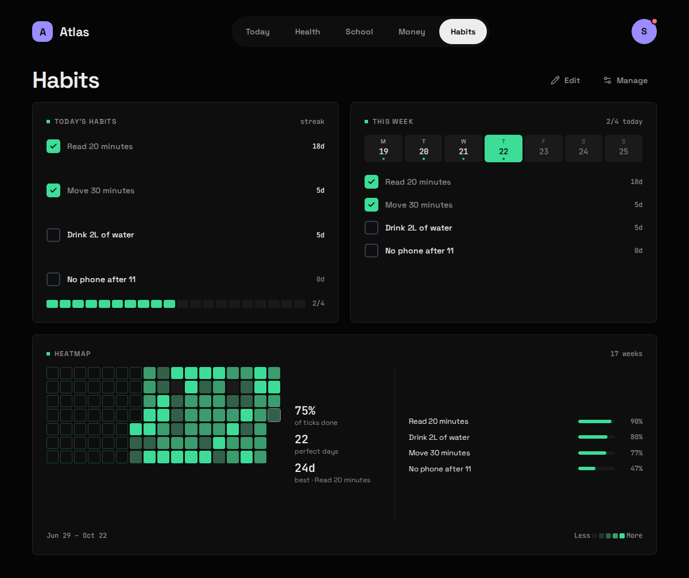
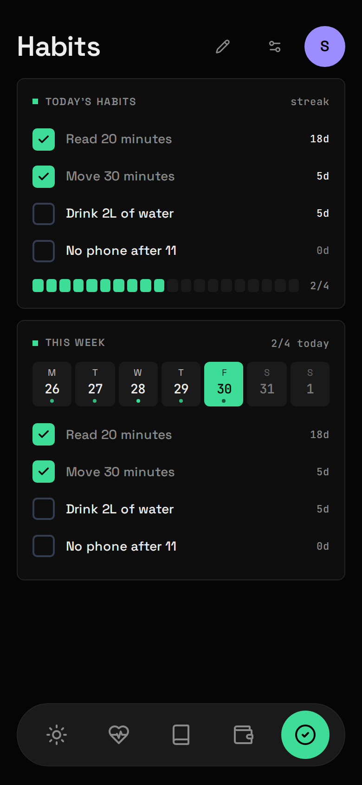

## What it shows

The habits you mean to do each day, ticked per local day, with streaks, and a week strip for Backfilling missed days.

| Widget | Sizes | Where |
|---|---|---|
| Today's habits | S M L | anywhere |
| This week | L | Habits only |

## What you need

Nothing. Habits has no Source: you are its upstream.

## Setup

1. Make sure `habits` is in `modules:` in `config/atlas.yaml` (it is in the example).
2. Open Habits and press **Manage** to add your habits. Manage is also where you rename, archive and restore them.
3. Tick a habit from a Today's habits Widget at Size **M** or **L**. At Size **S** the Widget is a count and meter with no tick buttons. To Backfill a day earlier this week, tap that day in the **This week** strip first, then tick.

## Config keys

None. Habits has no file in `config/modules/` and no secrets.

## What it stores

| Table | Holds |
|---|---|
| `habits` | Each habit: name, icon, order, when it was archived. |
| `habit_entries` | One row per tick: habit and local date. An untick is the row's absence. |

Your ticks are the only record anywhere, so include Atlas in your [backups](/atlas-dashboard/operate/backups/).

## Measured habits

With [Health](/atlas-dashboard/modules/health/) on, a habit can be linked in **Manage** to a Health figure and a target:

| Figure | Default target |
|---|---|
| Hours asleep | 8 h |
| Steps | 10,000 |
| Active minutes | 30 min |

After every Health sync, Atlas ticks the days in the last week where the figure reached the target. Linking re-checks the last 90 days, never before the habit was created. A day follows the figure's own rule: a Night counts for the morning you woke up.

**A manual tick or untick always wins.** It's stored as yours and never overwritten by a later sync, so Habits stays the one place where you are the authority.

## Gotchas

- **Days are local**, in `timezone` from `atlas.yaml`. If ticks land on the wrong day, check it.
- **Streaks are computed, never stored.** They're worked out from your ticks on every read, so ticking a missed day repairs every figure at once. Today's streak counts through yesterday until today is over.
- **A habit begins** at the earlier of its creation and its oldest tick, so backfilling before you added it counts, and the days before it existed never count as misses.
- **Archive is the way out.** Archiving stops a habit counting from that day on without rewriting the months it was live, and **Manage** can restore it. The app offers no delete; the API's `DELETE /api/habits/{id}` removes a habit and every tick it had.
- There's no "failed" state: no tick just means not done.
