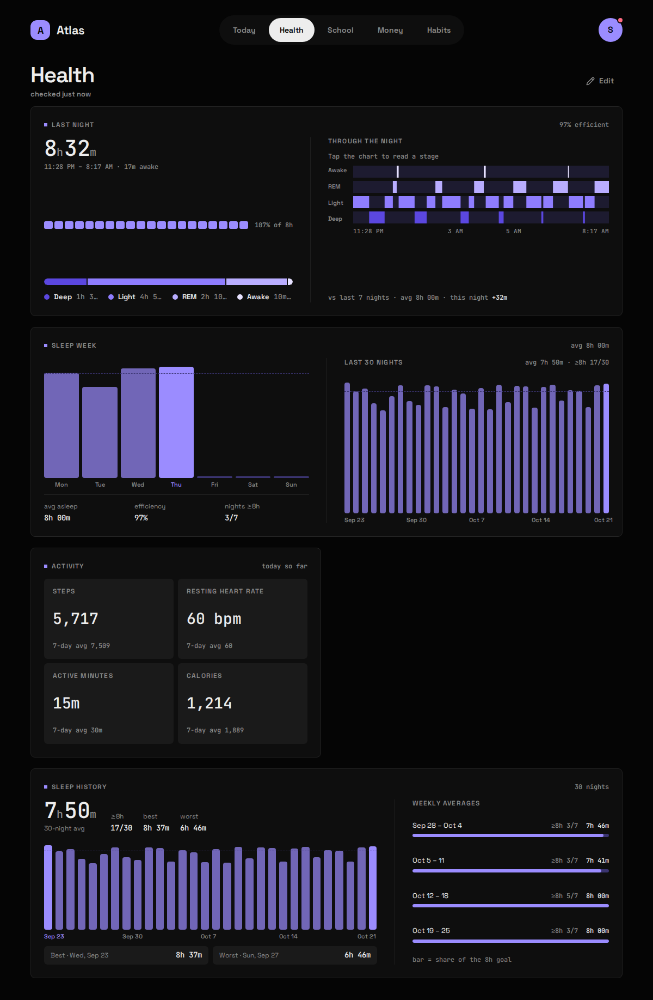
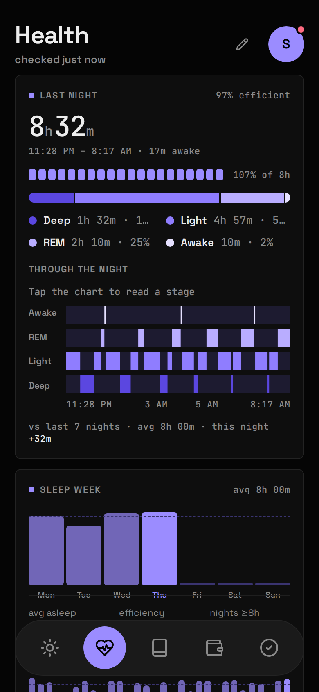

<div class="atlas-pair">





</div>

## What it shows

Last night's sleep with its stages through the night, the week's nights against an 8-hour line, today's steps, resting heart rate, active minutes and calories, and a 30-night history.

| Widget | Sizes | Where |
|---|---|---|
| Last night | S M L XL | anywhere |
| Sleep week | M L XL | anywhere |
| Activity | S M L | anywhere |
| Sleep history | L XL | Health only |

A **Night** is one main sleep session, filed under the date you woke up. Naps aren't Nights.

## What you need

- A Fitbit or Pixel Watch whose account is a **Google account** (see Gotchas).
- A Google Cloud project with an OAuth client. It's free and takes about ten minutes, once.
- An **HTTPS address** for Atlas that Google can redirect your browser back to, such as the one your reverse proxy serves. If you don't have one, there's a paste-back fallback.

This uses the **Google Health API** (`health.googleapis.com`), not `dev.fitbit.com`: the old Fitbit Web API was turned down in September 2026, and most tutorials online still describe it.

## Setup

In the [Google Cloud console](https://console.cloud.google.com/):

1. Create a project. Under **APIs & Services → Library**, enable **Google Health API**.
2. **Google Auth Platform → Branding**: an app name and your support email.
3. **Audience**: External, publishing status **Testing**. Add your own Google account under **Test users**.
4. **Data Access**: add the three read-only scopes:
   - `googlehealth.sleep.readonly`
   - `googlehealth.activity_and_fitness.readonly`
   - `googlehealth.health_metrics_and_measurements.readonly`
5. **Clients → Create**, type *Web application*. Under **Authorized redirect URIs** add the address you open Atlas at, plus `/api/sleep/oauth/callback`. **Copy the client secret now**: Google shows it once.

Then in Atlas:

6. Put the client in `.env`:

   ```bash
   GOOGLE_OAUTH_CLIENT_ID=...apps.googleusercontent.com
   GOOGLE_OAUTH_CLIENT_SECRET=...
   ```

7. Put the same redirect URI in `config/modules/google_health.yaml`:

   ```yaml
   redirect_uri: https://atlas.example.com/api/sleep/oauth/callback
   ```

8. Add `google_health` to `modules:` in `config/atlas.yaml` and `docker compose up -d`.
9. Open the **Status** screen (avatar menu) and press **Connect Fitbit**. Sign in with Google and allow all three scopes.

The first sync after connecting backfills 90 days.

If you looked around with the [demo data](/start/demo-data/) first, that still holds: the backfill window ignores the made-up nights, so the first real sync pulls the full 90 days. The made-up nights stay in the archive next to the real ones until you wipe them with `python -m app.demo --force` (or clear the tables). The Connect banner only says your 90 days are in once a real night is archived.

### No HTTPS address?

Register `http://localhost:8080/oauth/callback` on the client instead and set that as `redirect_uri`. The Status screen then opens Google in a new tab and asks you to paste back the address the browser lands on, even though that page won't load. No code change either way.

## Config keys

`config/modules/google_health.yaml`, plus `GOOGLE_OAUTH_CLIENT_ID` and `GOOGLE_OAUTH_CLIENT_SECRET` in `.env`.

| Key | Meaning |
|---|---|
| `redirect_uri` | Must match one of the client's authorized redirect URIs **exactly**, port included. |

The Module reports "needs setup" until all three are set. Whether an account is *connected* is separate: that's the Status screen.

## What it stores

Archived, hourly at :40.

| Table | Holds |
|---|---|
| `sleep_sessions` | Each sleep: start, end, the date you woke, main or nap, minutes asleep and awake, minutes per stage, the stage timeline, and the data point exactly as Google sent it. |
| `daily_activity` | One row per local day: steps, resting heart rate, light/moderate/vigorous minutes, calories. |
| `oauth_tokens` | The Google sign-in: access and refresh tokens and when they expire. In the database, never in `.env`. |

**Disconnect** on the Status screen revokes and forgets the sign-in; the Nights and activity it brought are kept.

## Gotchas

- **The sign-in lapses every 7 days, by design.** Every Google Health scope is *restricted*, so a personal app stays in Testing, where Google lets a refresh token live 7 days from consent however often it's used. Atlas knows the deadline: Today shows a **Reconnect** banner from two days out and again once it has lapsed. One tap fixes it. Leaving Testing would need Google's verification and a paid annual security assessment.
- **Your Fitbit account must be a Google account.** A legacy Fitbit login completes consent and then gets a 403 mentioning `UberMint`. Sign in to the Fitbit app with "Continue with Google" first. Atlas names this case.
- **All three scopes, not two.** Resting heart rate is a *health metric*; without that scope it's a 403. Unticking a box on Google's consent screen is caught and named.
- **`redirect_uri_mismatch`** means the URI in `google_health.yaml` and the one on the client differ, often just by port or trailing slash.
- **Hourly, not nightly.** Last night only exists once your watch syncs after you wake; a 4am run would leave the Widget a night behind all day.
- **Each run re-reads the last 7 days**, because Google finishes processing a night later and you can edit sessions in the Fitbit app. Within that window Google is the truth. A run that returns *no* sleep at all changes nothing: that's a watch that hasn't synced, not a week awake.
- **Missing is not zero.** An off-wrist day has no figures; a worn-but-idle day's steps are a true 0.
- **Efficiency is computed**, as time asleep over time in the sleep period, so it can differ from the Fitbit app by a point.
- With Health on, a Habit can [tick itself](/atlas-dashboard/modules/habits/#measured-habits) from hours asleep, steps or active minutes.
