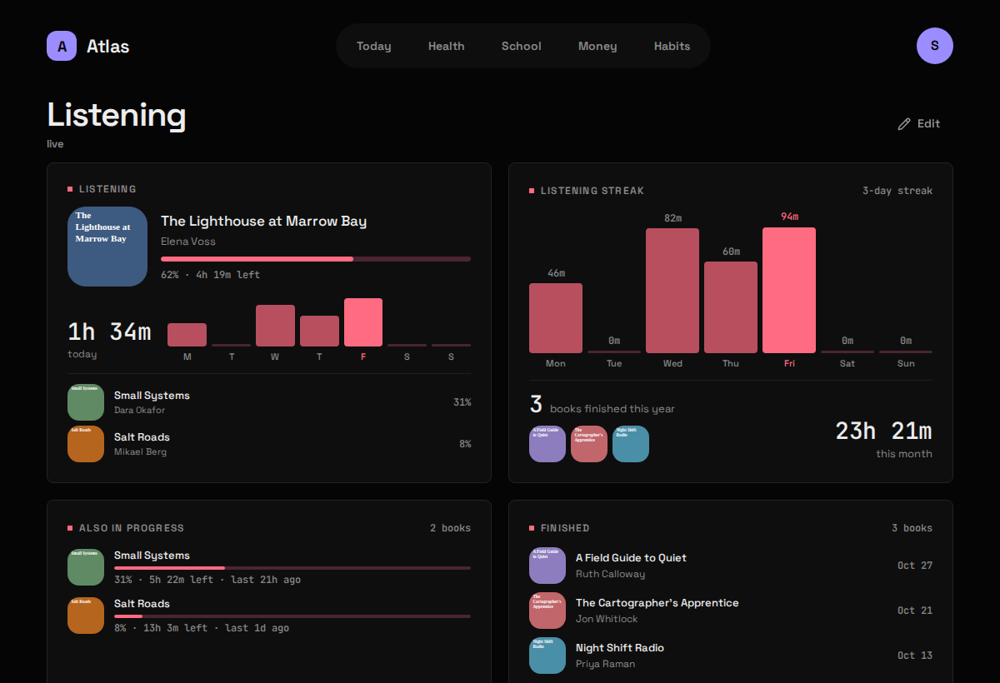

## What it shows

The audiobook you're in the middle of, with its cover and how far along you are, a listening streak, everything else in progress and what you've finished, from [Audiobookshelf](https://www.audiobookshelf.org/). Listening has no tab of its own: tap a Listening Widget to open its Board. The screenshot above is before setup.

| Widget | Sizes | Where |
|---|---|---|
| Now listening | S M L | anywhere |
| Listening streak | M L | anywhere |
| Also in progress | M L | Listening only |
| Finished | M L | Listening only |

## What you need

- An Audiobookshelf you run yourself, reachable from `atlas-api`.
- An API key from it: in Audiobookshelf, **Settings → API Keys**.

## Setup

1. Put the key in `.env`:

   ```bash
   ABS_TOKEN=...
   ```

2. Tell Atlas where Audiobookshelf is, in `config/modules/audiobookshelf.yaml`:

   ```yaml
   base_url: http://audiobookshelf:80             # where atlas-api reaches it
   public_url: https://books.example.com          # where your browser reaches it (optional)
   ```

3. If Audiobookshelf runs in Docker on the same machine, let `atlas-api` join its network with a [compose override](/atlas-dashboard/start/configuration/#reaching-your-other-apps).
4. Add `audiobookshelf` to `modules:` in `config/atlas.yaml`, then:

   ```bash
   docker compose up -d                      # up, not restart: .env changed
   curl -s 127.0.0.1:8187/api/listening/ | python3 -m json.tool
   ```

## Config keys

`config/modules/audiobookshelf.yaml`, plus `ABS_TOKEN` in `.env`.

| Key | Default | Meaning |
|---|---|---|
| `base_url` | `http://audiobookshelf:80` | Where `atlas-api` reaches Audiobookshelf. A Docker network name works here. |
| `public_url` | blank | Where your **browser** reaches it, for the "open in Audiobookshelf" link. Blank shows no link rather than a broken one. |

The Module reports "needs setup" until `ABS_TOKEN` is set.

## What it stores

**Live, stores nothing.** No table, no migration. What the Widget shows is a position in a book, and that stops being true the moment you press play on your phone; an archived copy could only ever be behind.

**Read-only, on purpose.** Nothing in Atlas writes to Audiobookshelf, so no dashboard bug can ever move your place in a book.

The sync every 15 minutes is a reachability probe that writes nothing, so a revoked key shows up on the Status screen rather than as an empty Widget.

## Gotchas

- **Covers go through Atlas.** Audiobookshelf wants the API key on every cover request, and an image in a web page could only carry it by showing it to anyone who opens the page. `atlas-api` fetches covers and serves them itself.
- **`base_url` is not `public_url`.** The first can be a Docker network name, which means nothing to your laptop's browser; the second is what the browser uses.
- **Ebooks count, but don't take over.** "Now listening" is the most recently advanced *audiobook*, so opening an epub once doesn't push the book you're eight hours into off the Widget.
- **A rejected key is named.** Audiobookshelf answers a bad key with a bare 401; Atlas reports it as a problem with `ABS_TOKEN`.
- **A stopped Audiobookshelf is an error, not a blank**, for the same reason as Money: there's no last-good reading to fall back on.
