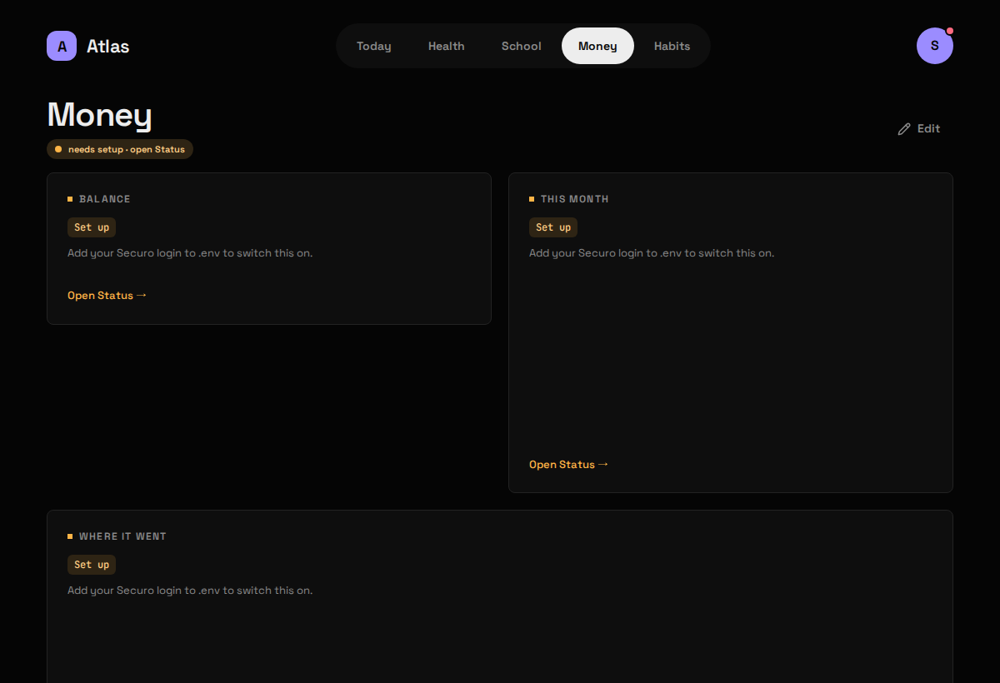

## What it shows

Your balance, this month's **In** and **Out**, where the money went by category, upcoming bills, accounts, savings goals and a few months of In vs Out, all read from Securo, a self-hosted personal-finance app. The screenshot above is Money before setup; once connected each Widget fills in.

| Widget | Sizes | Where |
|---|---|---|
| Balance | S M | anywhere |
| This month | M L | anywhere |
| Where it went | L XL | anywhere |
| Upcoming bills | M L | anywhere |
| Accounts | M L | Money only |
| Goals | M L | Money only |
| In vs Out | L XL | Money only |

## What you need

- A Securo you run yourself, reachable from `atlas-api`.
- The email and password of its account. **The account must not have two-factor auth on** (see Gotchas).

## Setup

1. Put the login in `.env`:

   ```bash
   SECURO_EMAIL=you@example.com
   SECURO_PASSWORD=...
   ```

2. Tell Atlas where Securo is, in `config/modules/securo.yaml`:

   ```yaml
   base_url: http://backend:8000       # where atlas-api reaches Securo's backend
   public_url: https://securo.example.com   # where your browser reaches it (optional)
   workspace_id: ""                   # optional; blank = the account's oldest
   ```

3. If Securo runs in Docker on the same machine, let `atlas-api` join its network with a [compose override](/atlas-dashboard/start/configuration/#reaching-your-other-apps). `http://backend:8000` then works as `base_url`.
4. Add `securo` to `modules:` in `config/atlas.yaml`, then:

   ```bash
   docker compose up -d atlas-api      # up, not restart: .env changed
   curl -s 127.0.0.1:8187/api/finance/ | python3 -m json.tool
   ```

## Config keys

`config/modules/securo.yaml`, plus `SECURO_EMAIL` and `SECURO_PASSWORD` in `.env`.

| Key | Default | Meaning |
|---|---|---|
| `base_url` | `http://backend:8000` | Where `atlas-api` reaches Securo's API. A Docker network name works here. |
| `public_url` | blank | Where your **browser** reaches Securo, for the "open Securo" link. Blank shows no link. |
| `workspace_id` | blank | Pin one Securo workspace. Blank uses the account's oldest, as Securo's own app does. |

The Module reports "needs setup" until both secrets are set.

## What it stores

**Live, stores nothing.** No table, no migration: every Widget reads straight through `atlas-api` to Securo on each request. Money already has a source of truth, and a second copy that drifts would be worse than none.

The browser never talks to Securo directly. Going through `atlas-api` keeps the login out of the web app, and suits Securo, which only accepts requests from its own front end anyway.

The sync every 15 minutes is a reachability probe that writes nothing, which is why Money's header says "live" or "unreachable" rather than "checked 4m ago".

## Gotchas

- **Two-factor auth on the Securo account stops this working.** Securo answers a 2FA login with "requires 2FA" instead of a token, and there's no unattended way past a code prompt. Atlas names that case on the Status screen. Use an account without 2FA, or a separate read-only one.
- **A stopped Securo is an error, not a blank.** With no archive behind it, Atlas says it couldn't reach Securo rather than drawing an empty balance.
- **The month in progress disagrees with itself slightly.** For the current month Securo's trend returns *projected* spending while its summary returns spending so far, so the last In vs Out bar and the Out figure differ until the month closes. That's Securo answering two different questions.
- **Uncategorised** spending is shown as a to-do line beside the categories, never as a bar of its own. It links to `public_url` so you can go and categorise it.
- **Amounts are in the workspace's primary currency**, already converted by Securo. Out is always shown as a positive amount.
- The login is a 24-hour token with no refresh. Atlas keeps it in memory and logs in again when it expires, about once a day.
