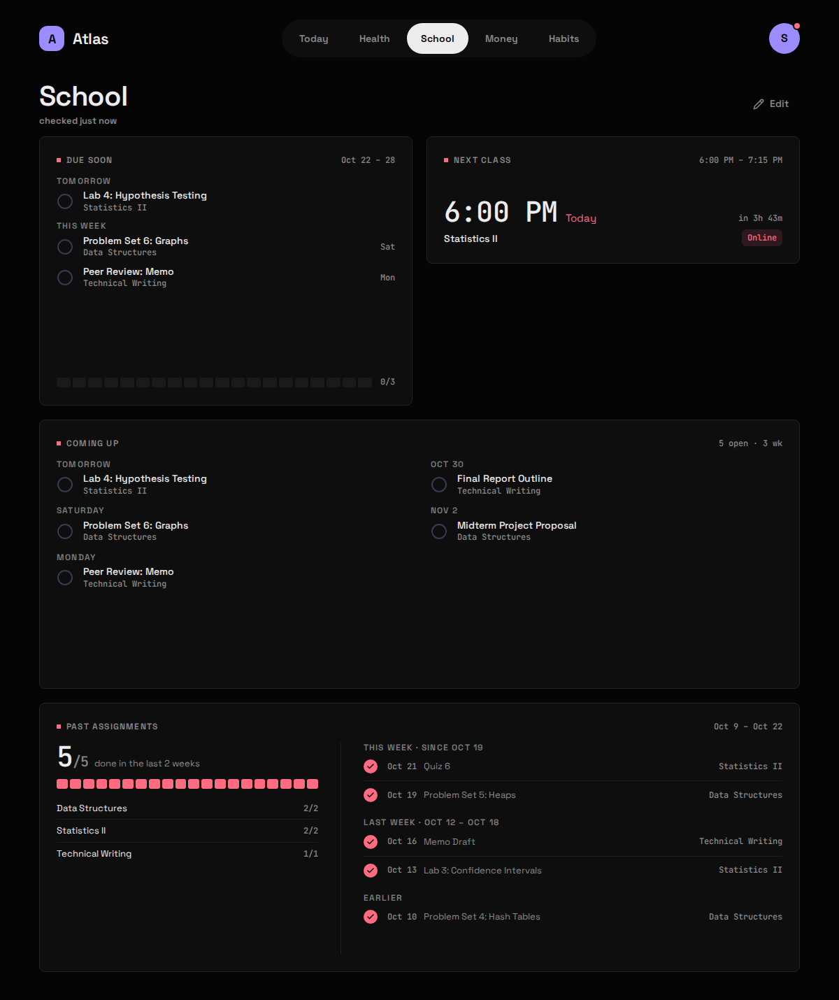
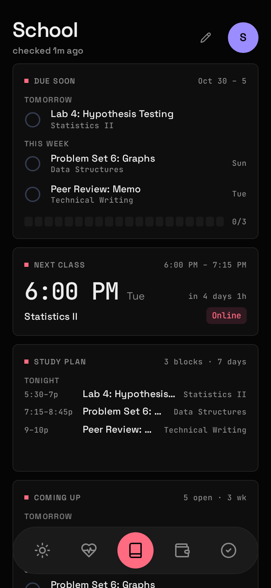

<div class="atlas-pair">





</div>

## What it shows

What's due this week and what's overdue, your next class session, three weeks of what's coming up, and the last few weeks of what you handed in. You tick an Assignment done yourself.

| Widget | Sizes | Where |
|---|---|---|
| Due soon | S M L | anywhere |
| Next class | S M | anywhere; on Today only on the day of the class |
| Study plan | M L | anywhere |
| Coming up | L XL | School only |
| Past assignments | L XL | School only |

Two kinds of thing come from Canvas, and Atlas treats them differently:

- An **Assignment** has a due time. It's the only thing you tick, and the only thing counted in "due this week".
- A **Class session** is a scheduled class meeting, with its join link if Canvas has one. It's a time, not a to-do: never ticked, never counted.

## Study plan

**Study plan** turns what's open and due in the next 7 days into suggested Study blocks, placed in your free time around Class sessions and, with the `work` module on, your Shifts. M shows the next block ("7–8:30p Tonight, Problem Set 6"); L lists the week's blocks by day.

- **How long each one takes** is guessed from its title: a discussion or reply 30 minutes, a quiz 45, a problem set, homework or lab 1h 30m, a paper, essay, project or report 3h, an exam, midterm, final or test 4h, and anything else 1h. Add your own words under `study.effort`.
- **Blocks are suggestions.** They're worked out fresh on every read and never stored or ticked: tick the Assignment and its blocks go. A new Shift or a moved due date reshuffles the plan the same way.
- **Earliest due first**, one block per assignment per day before any doubles up, so a paper spreads over the week instead of eating one evening.
- **Not enough time** is said plainly: if the free time before a due date can't cover the guess, the Widget says how short it is.
- **A Work week nobody entered** has unknown Shifts, so blocks may land on one; the L Widget says so.

## What you need

Your Canvas **calendar feed URL**. In Canvas, open **Calendar**, then **Calendar Feed**, and copy the link. It ends in `.ics`.

Canvas's full API needs a developer key that only a school's admins can issue. The calendar feed needs nothing: the URL carries its own token.

## Setup

1. Put the feed URL in `.env`. **It is a credential**: anyone with it can read your calendar.

   ```bash
   CANVAS_ICS_URL=https://<school>.instructure.com/feeds/calendars/user_<token>.ics
   ```

2. Optionally, give long course names short labels in `config/modules/canvas.yaml`:

   ```yaml
   course_labels:
     CS101: Intro CS
     Calculus II: Calc II
   ```

3. Add `canvas` to `modules:` in `config/atlas.yaml`, then:

   ```bash
   docker compose up -d                      # up, not restart: .env changed
   curl -X POST 127.0.0.1:8187/api/sync/school
   ```

## Config keys

`config/modules/canvas.yaml`, plus `CANVAS_ICS_URL` in `.env`.

| Key | Default | Meaning |
|---|---|---|
| `course_labels` | none | A map of `fragment: Label`. Each fragment is matched anywhere in Canvas's course name, ignoring case; the first match wins. Unmatched courses keep their full name. |
| `study.earliest` / `study.latest` | `8` / `22` | The hours Study blocks may fall between, as whole hours (0–24). |
| `study.max_block` / `study.min_block` | `90` / `30` | Longest and shortest block, in minutes. |
| `study.gap` | `15` | Minutes kept clear around a Shift or class, and between two blocks. |
| `study.buffer` | `2` | Hours before the due time to be finished by. Something already inside it gets what's left until it's due. |
| `study.days_off` | none | Weekdays with no study: `[sun]`, `[fri-sat]`. |
| `study.effort` | none | Words in an Assignment's title and the minutes it takes, checked before the built-in guesses: `{reading: 30}`. |

Labels are applied when reading, so changing them never rewrites anything stored, and the full name is still there as a tooltip. Because the first match wins, put longer fragments first: `Calculus I` would also catch `Calculus II`.

The Module reports "needs setup" until `CANVAS_ICS_URL` is set.

## What it stores

Archived, hourly at :15.

| Table | Holds |
|---|---|
| `assignments` | Every Assignment the feed has shown: title, course, due time, link, when it was first and last seen. |
| `assignment_status` | Your done ticks. The sync never touches this table. |
| `class_sessions` | Class sessions: course, start, end, join link. |

The first sync archives the whole term. From then on Atlas keeps what the feed forgets, which is why **Past assignments** can show weeks the feed has already dropped.

## Gotchas

- **The feed has no submission status**, so Canvas can't tell Atlas you handed something in. Ticking is yours.
- **Overdue means the last 7 days.** Without a cut-off, every assignment you handed in but never ticked would sit on the Widget forever. **Past assignments** never says "late" either: an unticked old row is most likely handed in.
- **"End of day".** Anything due at 11:59pm arrives from Canvas as a bare date; Atlas stores it as 23:59 local and shows "End of day".
- **An empty feed changes nothing.** That's likelier a feed problem than a term with nothing due, so Atlas keeps what it has.
- **An Assignment that vanishes** from the feed before its due date is hidden, and comes back if it reappears.
- **A reset feed shows as a 404.** If you reset the feed URL in Canvas, the sync fails with *HTTP 404, was the feed URL reset in Canvas?* Copy the new URL into `.env` and `docker compose up -d`.
- **The URL never leaves `.env`.** Sync errors are recorded without it, and the API keeps its HTTP client's logging quiet because it would otherwise print every request's full URL into `docker logs`.
