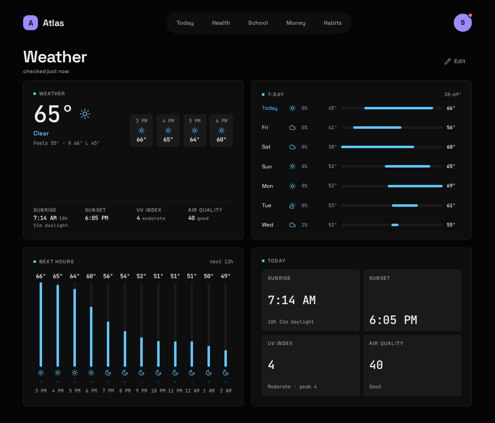

## What it shows

The temperature now with the day's high and low, the next few hours, a 7-day strip, sunrise and sunset, the UV index and US air quality. Weather has no tab of its own: tap a Weather Widget to open its Board.

| Widget | Sizes | Where |
|---|---|---|
| Now | S M L | anywhere |
| 7-day | M L | anywhere |
| Next hours | M L | Weather only |
| Today (sunrise, sunset, UV, air quality) | M L | Weather only |

## What you need

Nothing but your coordinates. [Open-Meteo](https://open-meteo.com/) is free for non-commercial use and needs no key.

## Setup

1. Make sure `open_meteo` is in `modules:` in `config/atlas.yaml` (it is in the example).
2. Put your coordinates in `config/modules/open_meteo.yaml`. Right-click a spot on most online maps to copy them.

   ```yaml
   latitude: 40.7128
   longitude: -74.0060
   units: fahrenheit        # or celsius
   ```

3. Apply it and fetch now rather than waiting for :07:

   ```bash
   docker compose restart atlas-api
   curl -X POST 127.0.0.1:8187/api/sync/weather
   ```

## Config keys

`config/modules/open_meteo.yaml`. No secrets.

| Key | Required | Meaning |
|---|---|---|
| `latitude` | yes | Decimal degrees, north positive. |
| `longitude` | yes | Decimal degrees, east positive. |
| `units` | no | `fahrenheit` (default) or `celsius`. Display only. |

Without both coordinates the Module reports "needs setup".

## What it stores

Archived, hourly at :07. Each sync makes three requests and keeps all of them:

| Table | Holds |
|---|---|
| `weather_observations` | One row per hour: a 120-hour window, two days back and three ahead, with UV and US AQI. |
| `weather_daily` | One row per local day: the 7-day forecast, sunrise, sunset, peak UV. |

Every row is upserted on its hour (or day), so a row written as a forecast is overwritten by the real reading once that hour has passed, and a missed run repairs itself on the next one. The Widgets read the archive, never Open-Meteo directly, so a failed sync costs Freshness, not the Widget.

Temperatures are stored in Celsius and UTC. `units` only changes how they're shown, so you can flip it at any time without touching the history.

## Gotchas

- **`503 The service is overloaded`** is Open-Meteo's free tier at the top of the hour. That's why the sync runs at :07, and why it retries a 429, a 5xx or a dropped connection twice (after 5s, then 15s) before recording a failure. A 400 is never retried: it means the coordinates are wrong.
- **Air quality is optional.** It comes from a separate Open-Meteo host; if that call fails, the weather still lands and the AQI already archived is left alone.
- **The day's high and low are local days**, in `timezone` from `atlas.yaml`, not UTC days that end in the evening.
