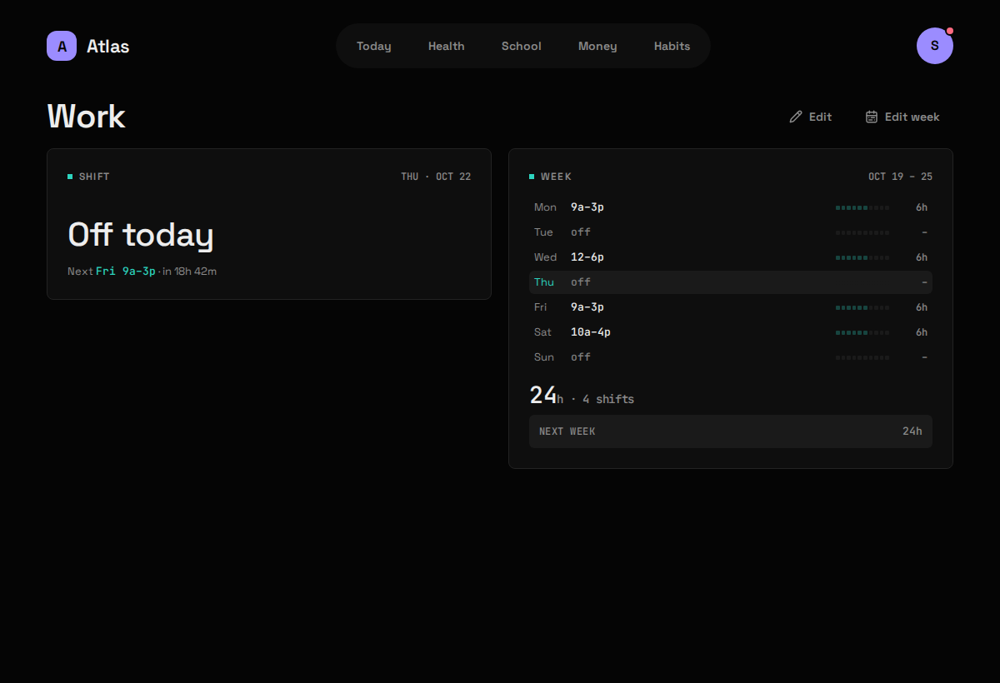
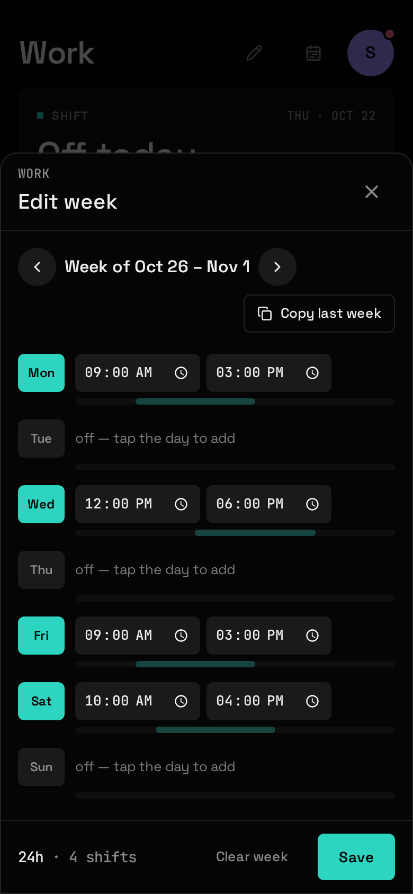

## What it shows

Today's shift, or "Off today" and when the next one starts, and the whole week with its total hours. Work has no tab of its own: tap a Work Widget to open its Board.

| Widget | Sizes | Where |
|---|---|---|
| Shift | S M | anywhere |
| Week | M L | anywhere |

## What you need

Nothing. Work has no Source: you type in each week's shifts.

## Setup

1. Add `work` to `modules:` in `config/atlas.yaml` and `docker compose restart atlas-api`.
2. Open Work (tap its Widget on Today) and press **Edit week**.
3. Tap a day to give it a shift, set the start and end, and **Save**. **Copy last week** fills the sheet from the week before, for a schedule that rarely changes. The arrows move between weeks.

A Widget showing a week you haven't entered yet takes you straight to that week's sheet.

## Config keys

None. Work has no file in `config/modules/` and no secrets.

## What it stores

| Table | Holds |
|---|---|
| `work_weeks` | One row per week you've saved, keyed on its Monday. |
| `work_shifts` | One row per working day: date, start, end. |

## Gotchas

- **"Off" and "not entered" are different.** A day with no shift in a week you've saved is a day off. A day in a week you've never saved is unknown, and the Widgets say "not entered" rather than pretending you're free. **Clear week** turns a week back into not entered.
- **A week is saved whole**, Monday to Sunday.
- **One shift a day, and it can't cross midnight.** The end must be after the start on the same day; an overnight shift has to be split.
