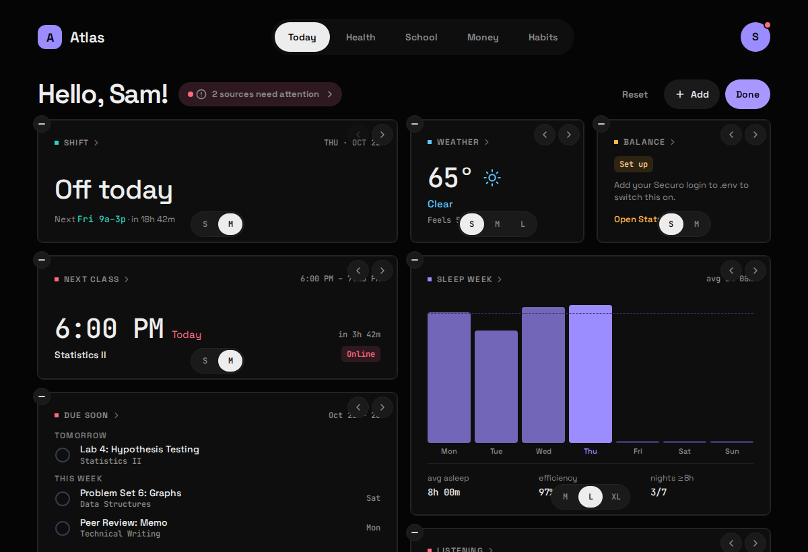
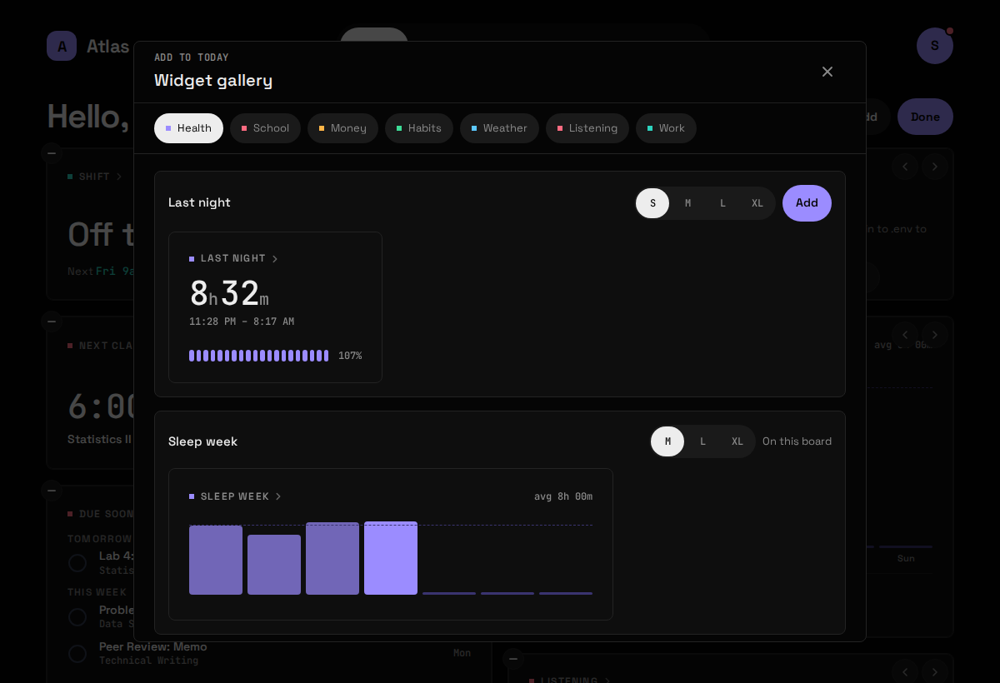
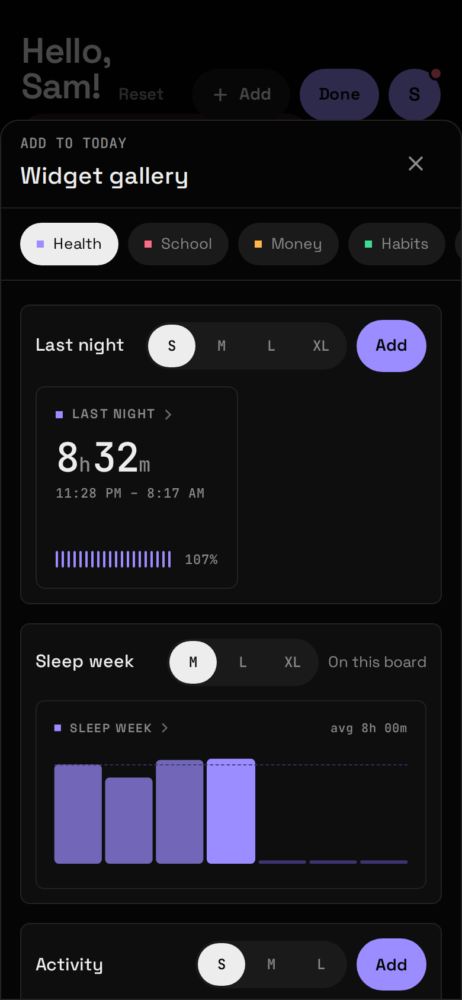

Every screen in Atlas is a **Board**: a grid of Widgets you arrange yourself. **Today** takes Widgets from every Area; each Area's own screen takes only that Area's Widgets. Arrangements are saved in Atlas's database, so they follow you from laptop to phone.

## Sizes

| Size | Desktop | Phone |
|---|---|---|
| **S** | 1 × 1 | 1 × 1 |
| **M** | 2 × 1 | 2 × 1 |
| **L** | 2 × 2 | 2 × 2 |
| **XL** | 4 × 2 | 2 × 4, standing tall |

The grid is four columns wide from 900px, two below. A bigger Size shows *more*: Last night at S is the figure and a meter; at XL it's the hypnogram and stage breakdown as well. Each Widget offers only the Sizes it looks right at.

## Edit mode

Tap **Edit** in a Board's header, or long-press any Widget. The Widgets start to wiggle, and each one gets:

- a **(–)** badge to remove it,
- a **Size switcher** with the Sizes it supports,
- **earlier / later** buttons, for the keyboard.

Drag a Widget to move it. **Add** opens the Widget gallery, **Reset** puts the Board back to its default, and **Done** saves. Escape does what Done does.

## The Widget gallery

The gallery lists every Widget you can still place on this Board, one tab per Area. Each entry shows a live preview at the Size you pick; **Add** drops it on the Board. A Widget already placed says "On this board".

## Area-only Widgets

Some Widgets are too detailed for a home screen and can be placed only on their own Area's Board, never on Today: Sleep history, Past assignments, Accounts, Goals, In vs Out, Next hours and a few more. They're marked in each [Module page's](/atlas-dashboard/modules/weather/) Widget table.

## When a Module goes away

Switch a Module off and its Widgets leave every Board. Saved Boards are checked against the Widgets that exist on every load, so a Widget that has gone, or a Size it no longer supports, can never break a Board: the tile is dropped or moved to the nearest Size it has.
