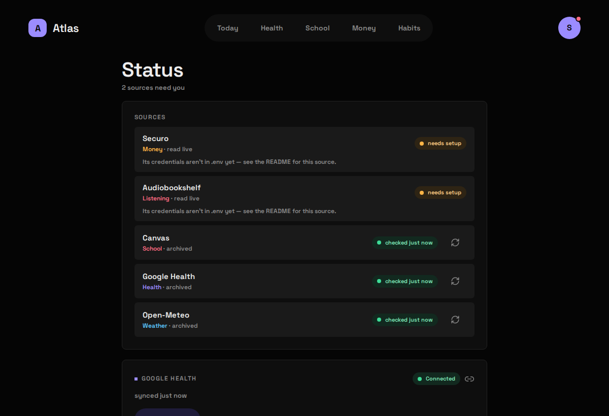

## The schedule

`atlas-cron` asks the API to sync each Source on a fixed schedule. Every attempt, success or failure, is recorded, which is what Freshness and the Status screen read.

| Source | Module | When | Kind |
|---|---|---|---|
| `weather` | `open_meteo` | hourly at :07 | archived |
| `school` | `canvas` | hourly at :15 | archived |
| `sleep` | `google_health` | hourly at :40 | archived |
| `finance` | `securo` | every 15 minutes | live probe |
| `listening` | `audiobookshelf` | every 15 minutes | live probe |

Habits and Work have no sync: you are their upstream. Cron also calls `notify` every 5 minutes, which sends any [Notifications](/atlas-dashboard/using/notifications/) that are due. It isn't listed on the Status screen; the Notifications card there shows its last check instead.

Weather runs at :07 rather than :00 because the top of the hour is when every cron job on the internet hits Open-Meteo's free tier at once. Health runs hourly, not nightly, because last night only exists once your watch syncs after you wake.

A **live** Source's "sync" stores nothing. It's a reachability probe, so a revoked key or a stopped server shows up on the Status screen instead of waiting to be found on an empty Widget.

### Sync by hand

```bash
curl -X POST 127.0.0.1:8187/api/sync/weather     # or school, sleep, finance, listening
curl -s 127.0.0.1:8187/api/sync/status | python3 -m json.tool
```

A Source whose Module is switched off answers `204` and does nothing, so cron stays quiet without you editing the crontab.

## Freshness

Each Area's header says how fresh its Source is:

- **checked 29m ago**: an archived Source, and when it was last read successfully.
- **live**: a live Source that answered its last probe.
- **needs setup · open Status**: the Module is on but its settings or secrets are missing.
- **sync failed**: an archived Source's last attempt failed. The Widgets keep showing the archive.
- **unreachable**: a live Source that didn't answer its last probe.

Habits and Work show no Freshness: there's nothing upstream to be fresh against.

## Problems

A **Problem** is a Source that needs you to act: not set up, signed out, unreachable. Today shows at most one chip for all of them ("2 sources need attention"); everything else lives on the Status screen.

## The Status screen

Behind the avatar menu, at `/status`. It lists every Source with its Area, whether it's archived or read live, its Freshness, and a sync-now button. It also holds the one connection with controls: Google Health's **Connect / Reconnect / Disconnect**.


