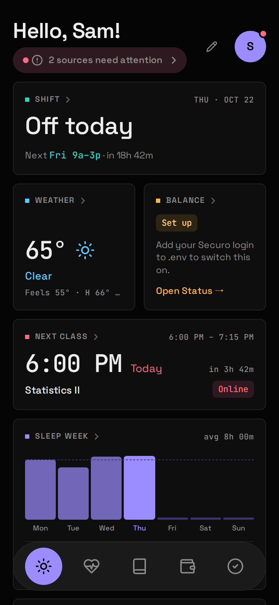

Today is the screen Atlas opens on: a [Board](/atlas-dashboard/using/boards-and-widgets/) of Widgets from every Area that's on, about today only.

## What's on it

- **The Greeting**, "Hello, Sam!", from `name` in `config/atlas.yaml`. Leave `name` blank for just "Hello!".
- **Widgets.** A fresh Today shows a default set (Shift, Weather, Balance, Next class, Sleep week, Due soon, Now listening, Today's habits), minus any whose Module is off. Make it yours in [Edit mode](/atlas-dashboard/using/boards-and-widgets/#edit-mode).
- **A Problem chip**, only when a Source needs you: "2 sources need attention". Tap it for the [Status screen](/atlas-dashboard/using/sync-and-freshness/#the-status-screen).
- **A Reconnect banner** for [Health](/atlas-dashboard/modules/health/), from two days before Google's weekly sign-in lapses.

## What it leaves out on purpose

Today never shows stale data dressed as current. There are no "synced 4h ago" stamps here: Freshness lives in each Area's header, and the only plumbing fact Today will tell you is that something needs you.

## Getting around

- **Tap a Widget** to open its Area. Weather, Listening and Work have no tab of their own; tapping one of their Widgets is the way in.
- On a **desktop** (900px and wider), Areas are in the pill nav at the top.
- On a **phone**, they're in the floating tab bar at the bottom, each lighting up in its own accent.
- The **avatar** opens the menu that holds the Status screen.
